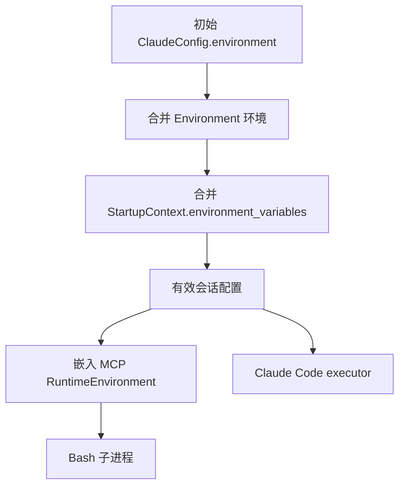

# 会话环境与嵌入 MCP

## 环境组装

Manager 在 `apply_environment_config` 中组装会话的有效 `ClaudeConfig.environment`，同名变量按以下顺序覆盖：

1. 初始 ClaudeConfig 环境。
2. Environment 类型提供的环境。
3. `StartupContext.environment_variables`。

StartupContext 的优先级与既有 Claude Code executor 一致。合并在工作目录为空时也必须执行。
最终配置用于嵌入 MCP 和后续 executor，原始 Environment 与 StartupContext 不被修改。

Brain 使用 `skip_claude_code`，在启动嵌入 MCP 后等待退出，不创建 Claude Code executor。
因此环境合并必须在 Manager 层完成，不能依赖 executor 的子进程环境构造。
`RuntimeMcpServer` 从最终配置复制会话环境，Bash 再按原有规则合并进程环境、provider 环境、非交互默认项和调用环境。

## Vault 边界

Go 的 Brain sandbox 启动请求通过 `startup_context.environment_variables` 传递 Vault 不透明占位符。
Manager 负责将这些值传给会话的工具执行环境，不解密 Vault，也不将它们写入全局进程环境。
此修复作用于新启动的 Manager；已运行的嵌入 MCP 保存了之前的环境副本，HTTP 服务重启不会更新该副本。

远端 MCP 的 Bearer/OAuth 注入和 Bash HTTP/HTTPS 出站秘密替换属于后台边界。Rust 本地回归只验证会话环境和 relay 传输；完整 CRED008 验收还依赖配套的 OMA 后端 HTTP 转发、Vault 替换与 Brain 启动载荷接线。

## 回归验证

`runtime_mcp_starts_in_skip_mode_and_stops_with_manager` 持有进程环境测试锁，启动真实嵌入 MCP 并调用真实 Bash，覆盖：

- 进程环境、初始 ClaudeConfig 和 Environment 环境保留。
- StartupContext 占位符可见，同名变量由 StartupContext 覆盖。
- StartupContext 变量不写入 Manager 的全局进程环境。
- skip 模式不执行 Claude Code，停止 Manager 会取消 Bash 并释放监听端口。

Linux 上的定向入口为 `cargo test --locked --lib internal::manager::manager_test`。

## Brain 出站 relay

Go 启动 Brain sandbox 时在 stdin 提供 session_ingress 认证、Code Session ID、use_code_sessions 和 relay 开关。恢复已有 Brain 的 sandbox 时签发当前 epoch 的 ingress token，不旋转 Brain Worker 凭据。
Manager 提前准备 relay，并将 relay 的 HTTP_PROXY/http_proxy、HTTPS_PROXY/https_proxy、NO_PROXY 和 CA 环境作为最高优先级传入嵌入 MCP。Bash 继承该会话配置，不写入 Manager 全局环境。

relay 区分 CONNECT 与 absolute-form HTTP：前者沿用 TLS 隧道，后者保留 method、绝对 URL、header 和 body，通过同一 WebSocket 分片协议交给后台。来自本地客户端的 Proxy-Authorization 被会话认证覆盖；后台响应直接作为 HTTP 响应返回，不给普通 HTTP 额外返回 CONNECT 200。

配套 OMA 后端改动与新 Linux ARM64 镜像完成了独立 VAULT-CRED-008 OMA-only 验收：重复创建返回 409，真实 Brain/Bash 通过 HTTP 接收端确认原值 A，原凭据状态保持，13 项检查通过且资源清理完成。该结果不是单独部署 Rust 变更的保证；旧后端只接受 CONNECT 时无法处理新增的普通 HTTP 请求。未覆盖全量 Brain 多节点及性能回归。
