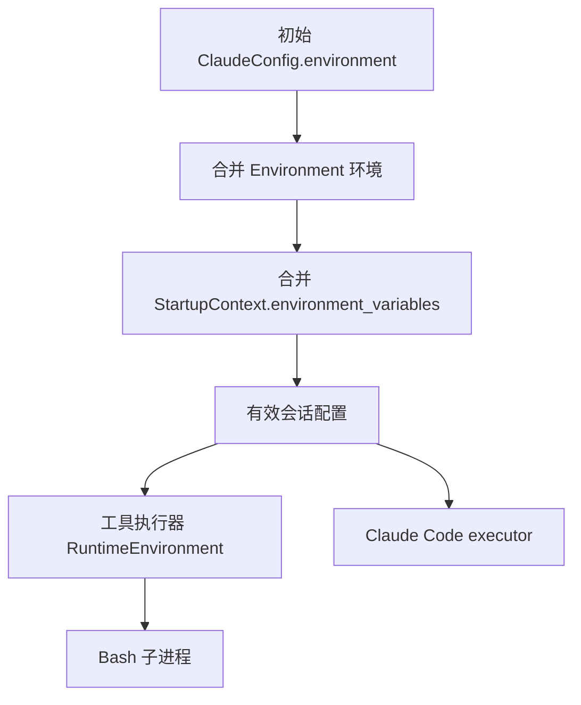

# 会话环境与工具领取

## 环境组装

Manager 在 `apply_environment_config` 中组装会话的有效 `ClaudeConfig.environment`，同名变量按以下顺序覆盖：

1. 初始 ClaudeConfig 环境。
2. Environment 类型提供的环境。
3. `StartupContext.environment_variables`。

StartupContext 的优先级与既有 Claude Code executor 一致。合并在工作目录为空时也必须执行。
最终配置用于工具执行器和后续 executor，原始 Environment 与 StartupContext 不被修改。

Brain 使用 `skip_claude_code`，在启动工具执行器后等待退出，不创建 Claude Code executor。
因此环境合并必须在 Manager 层完成，不能依赖 executor 的子进程环境构造。
`RuntimeToolCalls` 从最终配置复制会话环境，Bash 再按原有规则合并进程环境、provider 环境、非交互默认项和调用环境。

## Vault 边界

Go 的 Brain sandbox 启动请求通过 `startup_context.environment_variables` 传递 Vault 不透明占位符。
Manager 负责将这些值传给会话的工具执行环境，不解密 Vault，也不将它们写入全局进程环境。
此修复作用于新启动的 Manager；已运行的工具执行器保存了之前的环境副本，HTTP 服务重启不会更新该副本。

远端 MCP 的 Bearer/OAuth 注入和 Bash HTTP/HTTPS 出站秘密替换属于后台边界。Rust 本地回归只验证会话环境和 relay 传输；完整 CRED008 验收还依赖配套的 OMA 后端 HTTP 转发、Vault 替换与 Brain 启动载荷接线。

## 回归验证

`tool_claims_use_initialized_environment_and_stop_with_manager` 持有进程环境测试锁，启动真实工具执行器并调用真实 Bash，覆盖：

- 进程环境、初始 ClaudeConfig 和 Environment 环境保留。
- StartupContext 占位符可见，同名变量由 StartupContext 覆盖。
- StartupContext 变量不写入 Manager 的全局进程环境。
- skip 模式不执行 Claude Code，停止 Manager 会取消 Bash 并结束领取循环。

Linux 上的定向入口为 `cargo test --locked --lib internal::manager::manager_test`。

## Brain 出站 relay

Go 启动 Brain sandbox 时在 stdin 提供 session_ingress 认证、Code Session ID、use_code_sessions 和 relay 开关。恢复已有 Brain 的 sandbox 时签发当前 epoch 的 ingress token，不旋转 Brain Worker 凭据。
Manager 提前准备 relay，并将 relay 的 HTTP_PROXY/http_proxy、HTTPS_PROXY/https_proxy、NO_PROXY 和 CA 环境作为最高优先级传入工具执行器。Bash 继承该会话配置，不写入 Manager 全局环境。

relay 区分 CONNECT 与 absolute-form HTTP：前者沿用 TLS 隧道，后者保留 method、绝对 URL、header 和 body，通过同一 WebSocket 分片协议交给后台。来自本地客户端的 Proxy-Authorization 被会话认证覆盖；后台响应直接作为 HTTP 响应返回，不给普通 HTTP 额外返回 CONNECT 200。

配套 OMA 后端改动与新 Linux ARM64 镜像完成了独立 VAULT-CRED-008 OMA-only 验收：重复创建返回 409，真实 Brain/Bash 通过 HTTP 接收端确认原值 A，原凭据状态保持，13 项检查通过且资源清理完成。该结果不是单独部署 Rust 变更的保证；旧后端只接受 CONNECT 时无法处理新增的普通 HTTP 请求。未覆盖全量 Brain 多节点及性能回归。

## 内置工具领取

Brain 模式 Manager 使用会话 ingress token 主动请求 OMA 的工具领取接口，按空闲槽位领取并最多同时执行 4 个调用。注册表继续提供 Bash、Read、Write、Edit、Grep 和 Glob 的输入校验与执行。started 响应为 running 后，先原子保存 started 标记并同步，再执行工具。结果字节写入 ledger 后按 SHA-256 幂等上报。OMA 只交付 pending 调用，已 running 的调用不会再次交付，因此 Manager 启动领取循环前先扫描 ledger：删除未完成 rename 的临时文件，并按文件名中的调用 UUID 与 attempt 补报每个已保存的结果，补报期间同样发送心跳。上报成功或收到永久拒绝后删除该结果文件；关闭期间未完成的补报保留文件，留待下次启动。started 标记保留，用于拒绝同一调用的重复执行。

started 是提交点：Manager 只有在 started 返回 running 后才启动工具，OMA 可以独立回收提交点之前的调用。结果状态只描述发生了什么：`succeeded`、`failed` 或 `interrupted`，`interrupted` 通过 `Oma-Result-Reason` 给出 `stop_requested`、`deadline` 或 `executor_shutdown`，附带中断前的部分输出。未知工具与输入校验失败直接以 `failed` 上报。

Manager 退出使用排空和中止两个信号：先停止领取并放弃在途领取请求，尚未 started 的调用发送 reject；执行中的调用有 10 秒宽限期自然结束；宽限期后中止进程组，以 `interrupted` + `executor_shutdown` 写入 ledger 并上报，结果末尾追加退出说明；再给 5 秒上报预算，超时后保留 ledger 留待下次启动补报。

心跳与执行 deadline 同时推进，心跳网络等待不会阻止本地停止。收到取消或本地到期后终止进程组，等待退出，再上报包含部分输出的 stopped 结果。Manager 的 HTTP MCP 入口已移除。
